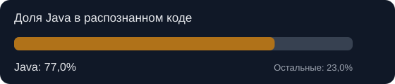
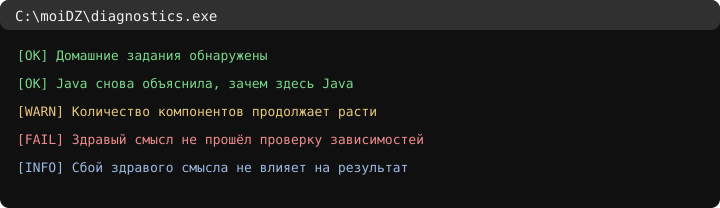

<!-- Файл сгенерирован Java. Изменяй tools/jokes/*.json, не этот файл. -->
<!-- jokes: 9,28,17,26,3 -->
# Репозиторий для домашних заданий

> Репозиторий с домашними заданиями. Я бы объяснил, как всё работает, но боюсь спугнуть.

## 🐍 Введение в Python

Тут код на Python. Не пугайтесь длинных имён файлов: иногда это единственная доступная документация.

[Открыть `python/`](python)

| Папка | Файлов внутри |
|---|---:|
| [homeworks/](python/homeworks) | 24 |

## 🛠️ Индивидуальный проект

План проекта существовал. Очень красивый был план. Жаль, что проект его не читал.

[Открыть `индивидуальныйПроект/`](%D0%B8%D0%BD%D0%B4%D0%B8%D0%B2%D0%B8%D0%B4%D1%83%D0%B0%D0%BB%D1%8C%D0%BD%D1%8B%D0%B9%D0%9F%D1%80%D0%BE%D0%B5%D0%BA%D1%82)

| Папка | Файлов внутри |
|---|---:|
| [classworks/](%D0%B8%D0%BD%D0%B4%D0%B8%D0%B2%D0%B8%D0%B4%D1%83%D0%B0%D0%BB%D1%8C%D0%BD%D1%8B%D0%B9%D0%9F%D1%80%D0%BE%D0%B5%D0%BA%D1%82/classworks) | 6 |
| [homeworks/](%D0%B8%D0%BD%D0%B4%D0%B8%D0%B2%D0%B8%D0%B4%D1%83%D0%B0%D0%BB%D1%8C%D0%BD%D1%8B%D0%B9%D0%9F%D1%80%D0%BE%D0%B5%D0%BA%D1%82/homeworks) | 4 |

## ☕ Java

Java умеет многое. Здесь ей доверили самое ответственное: менять подписи под папками.

Java 21 · GitHub Actions · [Исходник генератора](tools/ReadmeGenerator.java)

**Доля Java:** 77,0% распознанного кода GitHub.

> Java почти поглотила репозиторий. Отчёт об этом, разумеется, подготовила Java.

### Диагностический журнал

## ☢️ Оценка опасности домашних заданий

*Шуточный индекс сложности файловой структуры, а не проверка правильности решений.*

| Раздел | Баллы условной угрозы | Заключение |
|---|---:|---|
| [Введение в Python](python) | 100 | Документы переданы комиссии |
| [Индивидуальный проект](%D0%B8%D0%BD%D0%B4%D0%B8%D0%B2%D0%B8%D0%B4%D1%83%D0%B0%D0%BB%D1%8C%D0%BD%D1%8B%D0%B9%D0%9F%D1%80%D0%BE%D0%B5%D0%BA%D1%82) | 65 | Документы переданы комиссии |

Оценка зависит от числа файлов, вложенности, объёма кода и отметок `TODO`/`FIXME`. Угроза носит исключительно бумажный характер.

## 📜 Летопись технических происшествий

Все зарегистрированные события: [INCIDENTS.md](INCIDENTS.md).

> Количество файлов Python изменилось: 22 → 25.

## 📐 Аудит неоправданной сложности

| Показатель | Значение |
|---|---:|
| Java-файлов инфраструктуры | 4 |
| JSON-файлов с шутками | 5 |
| Строк в инструментах Java | 510 |
| Строк учебного исходного кода | 374 |

**Индекс:** 1,4 строки инфраструктуры на строку учебного кода.

Считаются все строки исходников, включая пустые; это шуточный показатель объёма, не оценка качества.

---

## 🎲 Вердикт дня

> Компьютер сделал именно то, что я написал. К сожалению, не то, что я хотел.
