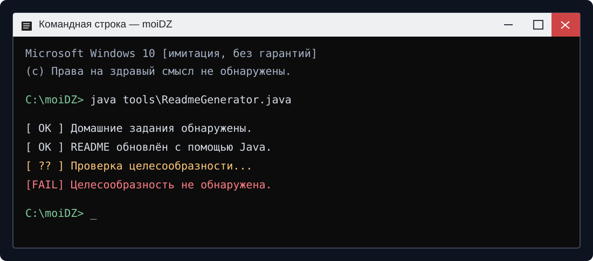

<!-- Этот файл создан Java. Шутки находятся в tools/jokes/*.json -->
<!-- jokes: 14,2,17,16,1 -->
# Репозиторий для домашних заданий

> Здесь собраны результаты обучения. По крайней мере, так утверждает название дисциплины.

## 🐍 Введение в Python

Здесь обитает код на Python. Большинство экземпляров безобидны, пока их не запустить.

[Открыть папку `python`](python)

**Файлов:** 17

| Папка | Файлов внутри |
|---|---:|
| [homeworks/](python/homeworks) | 16 |

## 🛠️ Индивидуальный проект

План проекта существовал. Очень красивый был план. Жаль, что проект его не читал.

[Открыть папку `индивидуальныйПроект`](%D0%B8%D0%BD%D0%B4%D0%B8%D0%B2%D0%B8%D0%B4%D1%83%D0%B0%D0%BB%D1%8C%D0%BD%D1%8B%D0%B9%D0%9F%D1%80%D0%BE%D0%B5%D0%BA%D1%82)

**Файлов:** 4

| Папка | Файлов внутри |
|---|---:|
| [homeworks/](%D0%B8%D0%BD%D0%B4%D0%B8%D0%B2%D0%B8%D0%B4%D1%83%D0%B0%D0%BB%D1%8C%D0%BD%D1%8B%D0%B9%D0%9F%D1%80%D0%BE%D0%B5%D0%BA%D1%82/homeworks) | 4 |

## ☕ Java

Чтобы не писать README вручную, я написал программу, которая пишет README автоматически. Теперь исправлять приходится два файла. Прогресс.

**Доля Java в распознанном коде репозитория:** 80,1%.

> Судя по статистике, README постепенно поглощает репозиторий, который должен был описывать.

Генератор: [`tools/ReadmeGenerator.java`](tools/ReadmeGenerator.java) · Java 21 · GitHub Actions.

---

## 🎲 Вердикт дня

> Компьютер не жалуется. Возможно, он просто уже всё понял.

