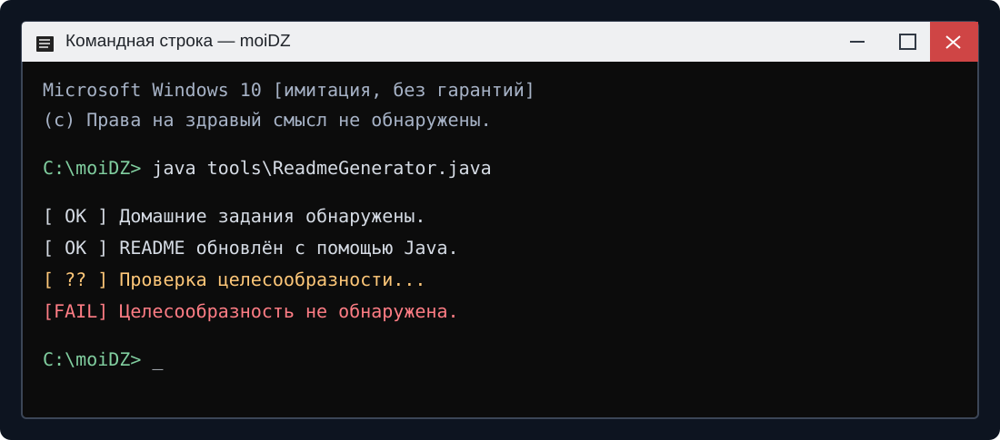

<!-- Файл сгенерирован Java. Изменяй tools/jokes/*.json, не этот файл. -->
<!-- jokes: 26,10,18,24,10 -->
# Репозиторий для домашних заданий

> Если вы здесь по ссылке от преподавателя, то это действительно нужный репозиторий. К сожалению, для нас обоих.

## 🐍 Введение в Python

Отступил на четыре пробела. От собственных принципов — чуть больше.

[Открыть `python/`](python)

| Папка | Файлов внутри |
|---|---:|
| [homeworks/](python/homeworks) | 21 |

## 🛠️ Индивидуальный проект

Это индивидуальный проект. По крайней мере, название обещает, что совещаний будет меньше.

[Открыть `индивидуальныйПроект/`](%D0%B8%D0%BD%D0%B4%D0%B8%D0%B2%D0%B8%D0%B4%D1%83%D0%B0%D0%BB%D1%8C%D0%BD%D1%8B%D0%B9%D0%9F%D1%80%D0%BE%D0%B5%D0%BA%D1%82)

| Папка | Файлов внутри |
|---|---:|
| [classworks/](%D0%B8%D0%BD%D0%B4%D0%B8%D0%B2%D0%B8%D0%B4%D1%83%D0%B0%D0%BB%D1%8C%D0%BD%D1%8B%D0%B9%D0%9F%D1%80%D0%BE%D0%B5%D0%BA%D1%82/classworks) | 6 |
| [homeworks/](%D0%B8%D0%BD%D0%B4%D0%B8%D0%B2%D0%B8%D0%B4%D1%83%D0%B0%D0%BB%D1%8C%D0%BD%D1%8B%D0%B9%D0%9F%D1%80%D0%BE%D0%B5%D0%BA%D1%82/homeworks) | 4 |

## ☕ Java

README выглядит как текст. За кулисами у текста полноценное приложение. Не спрашивайте о бюджете.

Java 21 · GitHub Actions · [Исходник генератора](tools/ReadmeGenerator.java)

**Доля Java:** 77,0% распознанного кода GitHub.

> Java почти поглотила репозиторий. Отчёт об этом, разумеется, подготовила Java.

### Диагностический журнал

## ☢️ Оценка опасности домашних заданий

*Шуточный индекс сложности файловой структуры, а не проверка правильности решений.*

| Раздел | Баллы условной угрозы | Заключение |
|---|---:|---|
| [Введение в Python](python) | 100 | Документы переданы комиссии |
| [Индивидуальный проект](%D0%B8%D0%BD%D0%B4%D0%B8%D0%B2%D0%B8%D0%B4%D1%83%D0%B0%D0%BB%D1%8C%D0%BD%D1%8B%D0%B9%D0%9F%D1%80%D0%BE%D0%B5%D0%BA%D1%82) | 65 | Документы переданы комиссии |

Оценка зависит от числа файлов, вложенности, объёма кода и отметок `TODO`/`FIXME`. Угроза носит исключительно бумажный характер.

## 📜 Летопись технических происшествий

Все зарегистрированные события: [INCIDENTS.md](INCIDENTS.md).

> Изменилось количество учебных подпапок. Файловая система просит объяснений.

## 📐 Аудит неоправданной сложности

| Показатель | Значение |
|---|---:|
| Java-файлов инфраструктуры | 4 |
| JSON-файлов с шутками | 5 |
| Строк в инструментах Java | 510 |
| Строк учебного исходного кода | 334 |

**Индекс:** 1,5 строки инфраструктуры на строку учебного кода.

Считаются все строки исходников, включая пустые; это шуточный показатель объёма, не оценка качества.

---

## 🎲 Вердикт дня

> README обновился сам. Прогресс технический, причины психологические.
